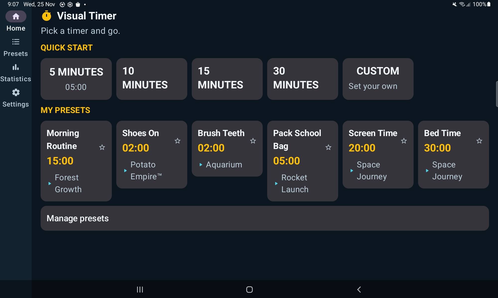
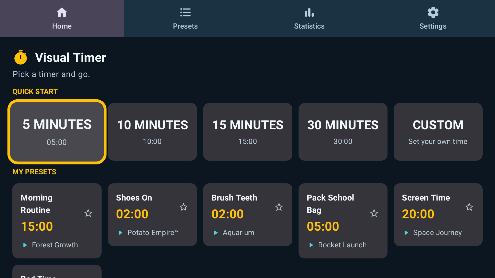
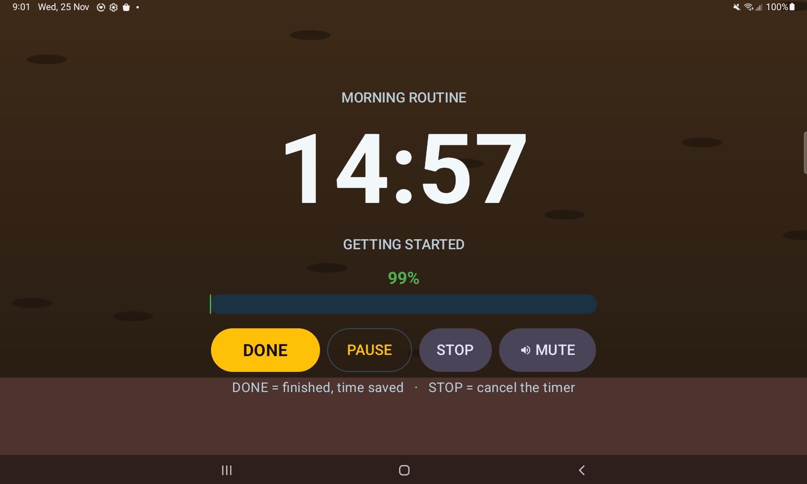
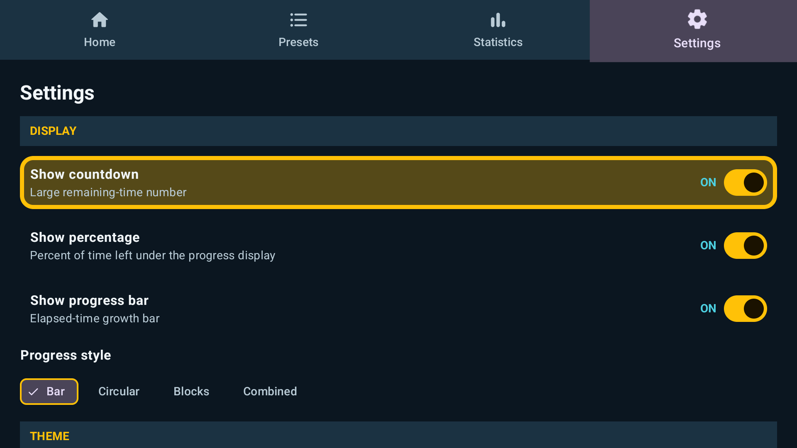
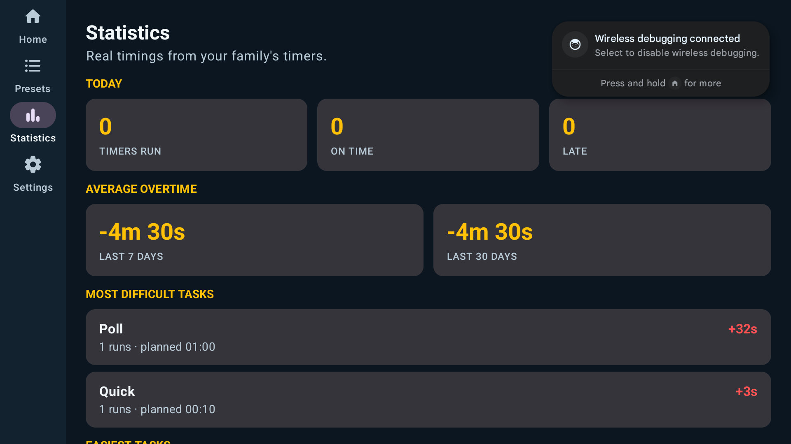
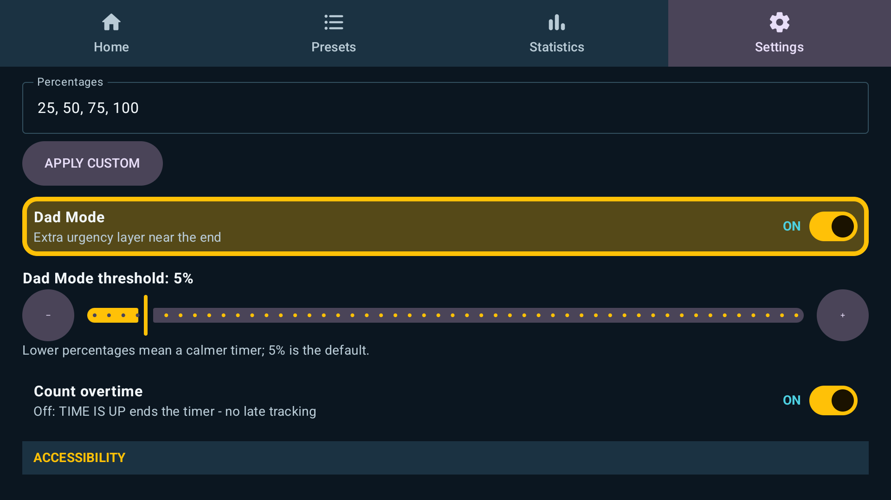
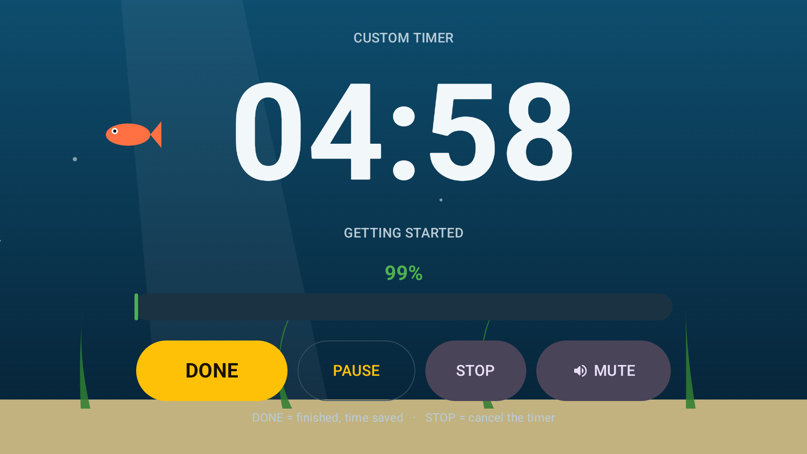

# Visual Timer

An Android app that makes the passage of time **visual** for children aged 6–12, built for
**Android TV** first, with tablet and phone support from the same codebase.

Instead of an abstract countdown, remaining time is shown as a growing bar, filling pie,
block countdown and an animated environment (a plant growing, a rocket climbing, fish
appearing in an aquarium...). When the timer expires, overtime can keep counting so parents
get real data about how long tasks actually take — or it can stop dead at zero if you prefer.

## Screenshots

| Android tablet | Android TV |
| --- | --- |
|  |  |
|  |  |
|  |  |
|  | |

## Features

| Area | What's implemented |
| --- | --- |
| Home | Large quick-start cards (5/10/15/30 min, custom) plus the family's presets |
| Custom timer | Hours/minutes/seconds steppers + one-press quick-set chips, 10 s – 24 h validation |
| Running timer | Countdown sized for 5–10 m legibility, elapsed-growth progress, pause/resume |
| Progress modes | Bar, circular, blocks, combined (bar + percentage) |
| Themes | Forest Growth, Rocket Launch, Aquarium, Space Journey, Potato Empire™, Random |
| Warning system | 50 % chime → 25 % voice → 10 % voice + highlight → 5 % Dad Mode → expiry. Nothing is announced below 15 seconds remaining - short timers stay quiet and only say "time is up" |
| Dad Mode | Adjustable 1–50 % threshold: dim, pulsing bar, flashing amber frame, spoken prompt |
| Overtime | Optional and **off by default**. On: keeps counting past zero ("TIME IS UP · LATE BY 00:34"). Off (default): zero ends it |
| Analytics | Today's runs/on-time/late, 7 & 30 day average overtime, most difficult / easiest tasks |
| Presets | Parent-editable name, duration, theme, warning profile, favourite |
| Settings | Remote-first: whole-row toggles, wrapping chips, ON/OFF labels, mute button on the timer |
| Accessibility | High contrast, large text, reduced motion, colour-blind palette, mute mode |
| Platforms | D-Pad/OK/Back only operation on TV; touch-friendly layouts on tablet/phone |
| Offline | 100 % offline, no accounts, no ads, no telemetry |

## Install on your TV, tablet or phone

1. Get the APK from the latest [release](https://github.com/ben0551/visual-timer/releases)
   (`visual-timer-*-debug.apk`) — debug-signed, so it installs anywhere.
2. Connect a machine with `adb` to the device:

   - **Android TV**: Settings → System → About → tap *Build* 7× → back to System →
     *Developer options* → enable **Wireless debugging**. The port is random and changes
     when the TV restarts; discover it with the helper
     [`gtv.py find-port`](https://github.com/ben0551/visual-timer/blob/main/scripts/)
     or read it under "Wireless debugging" on screen.
   - **Phone/tablet**: Settings → Developer options → **Wireless debugging** (USB works too).
3. Pair/connect once, then install:

```bash
adb pair <ip>:<port>          # only if asked for the pairing code
adb connect <ip>:<port>
adb install -r visual-timer-vX.Y-debug.apk
```

4. Open **Visual Timer** from the launcher (it also appears in the TV home-screen row).
   First launch seeds starter presets (Morning Routine, Shoes On, Brush Teeth, ...).

The app needs **no permissions**, no account and no network access.

## Use with an AI agent (Hermes / OpenClaw / Claude Code / Codex…)

Any agent that can run a shell command can drive the app over adb — the same
call-with-parameters pattern as an MCP tool, but no MCP server to host. Hermes ships a
skill for it; other harnesses just run the repo scripts.

```bash
./scripts/tv_timer.sh 15 POTATO "Morning Routine"   # 15 minutes, potato theme
./scripts/tv_timer.sh 8:45                          # countdown until 8:45 ("8:45 Timer")
./scripts/tv_preset.sh "Morning Routine"            # launch the stored preset
```

Deep link / intent contract:

```
visualtime://timer?seconds=900&name=Morning%20Routine&theme=POTATO&profile=DEFAULT
visualtime://timer?preset=Morning%20Routine          # resolve a stored preset by name/id
visualtime://timer?until=8:45                        # wall-clock target -> countdown to 8:45
```

Extras equivalent: `--ei vta_seconds 900 --es vta_name "Morning Routine"
--es vta_theme POTATO --es vta_profile DEFAULT`, `--es vta_preset "Morning Routine"`,
or `--es vta_until "8:45"` (the app works out the remaining time and titles it
`8:45 Timer`; a time that has already passed counts down to tomorrow's).

Say *"set a timer on the TV to 15"*, *"dinner at 8:45"* or *"start my Morning Routine
preset"* to Hermes and it maps onto those commands (see the `visual-timer`
skill). Full parameter table, behaviour notes and verification steps are in
**[AGENTS.md](AGENTS.md)**.

Example agent conversation:

> **You:** put 10 minutes on the TV
> **Agent:** `./scripts/tv_timer.sh 10` → app opens on the running timer showing 09:5x

> **You:** start the Bed Time preset
> **Agent:** `./scripts/tv_preset.sh "Bed Time"` → resolves to 30 min, Space theme

> **You:** shower at 6:15
> **Agent:** `./scripts/tv_timer.sh 6:15` → countdown from now until 6:15, titled 6:15 TIMER

## Tech stack

Kotlin · Jetpack Compose (Material 3) · Compose Navigation · Room · Hilt · MVVM · Coroutines/Flow.

```
ui (Composables) → ViewModel (StateFlow) → Repository → Room DAO → SQLite
```

One Compose UI adapts by window width: bottom navigation bar below 600 dp, navigation rail above.
The running timer is full-screen with no chrome.

## Build

Requires JDK 17 and the Android SDK (compileSdk 35).

```bash
echo "sdk.dir=/path/to/Android/Sdk" > local.properties   # or set $ANDROID_HOME
./gradlew assembleDebug            # APK at app/build/outputs/apk/debug/
./gradlew testDebugUnitTest        # JVM unit tests
```

Release builds are signed with the debug key so they can be sideloaded as-is.

## Project layout

```
app/src/main/java/com/ben0551/visualtimeassistant/
├── VisualTimeApp.kt            # @HiltAndroidApp, seeds presets/settings on first launch
├── MainActivity.kt             # deep-link/intent entry point + edge-to-edge Compose host
├── data/                       # Room entities, DAOs, DB (+ migration), repositories, mappers
├── domain/model/               # ThemeId, DisplayMode, WarningProfileId, settings, records
├── domain/stats/               # StatsCalculator (pure, unit tested)
├── timer/MilestoneEvaluator.kt # warning engine (pure, unit tested)
├── service/                    # SpeakerAnnouncer (TTS), ChimePlayer (ToneGenerator)
└── ui/
    ├── navigation/             # routes + adaptive shell (bottom bar / rail)
    ├── theme/                  # dark palette, high-contrast palette, progress ramp
    ├── components/             # progress visuals, animated themes, remote-safe controls
    └── home|custom|running|presets|stats|settings/
```

### Timing accuracy

The timer anchors to `SystemClock.elapsedRealtime()` (monotonic clock) and recomputes elapsed
time every 200 ms tick, so it does not drift even if the process is throttled. Pausing banks
the accumulated time before stopping the ticker.

### Data recorded per session

`TimerSession` stores start/end timestamps, planned vs actual duration, overtime (signed),
completed-on-time flag, preset id/name, theme, warning profile and display mode. Overtime is
negative when a task finished early, which powers the "easiest tasks" list.

## Roadmap

Companion parent remote · child profiles · custom recorded parent voice · routine chains ·
achievements · household sync · Wear OS notifications · AI duration recommendations.
